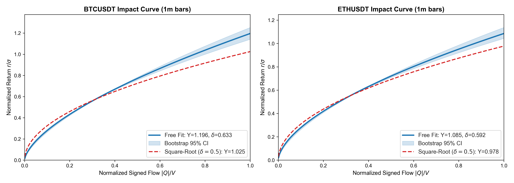
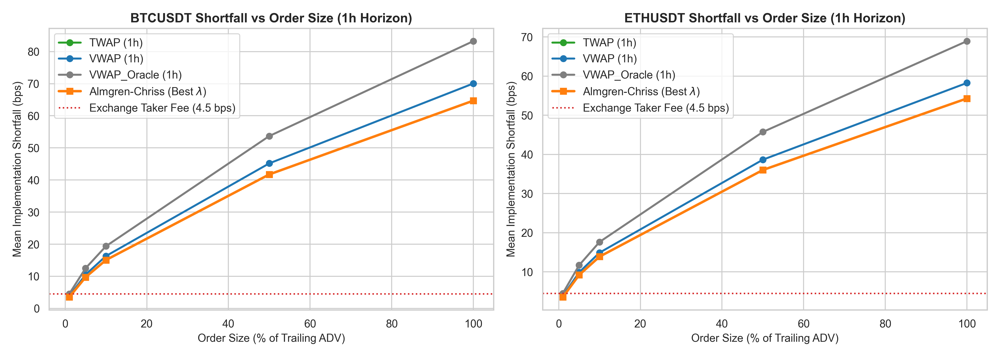
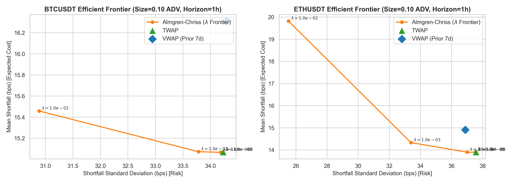
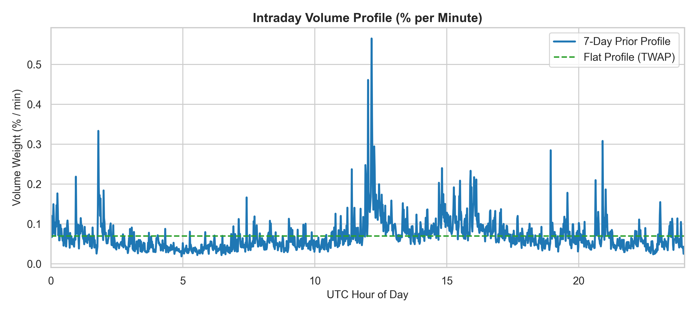

# Market Impact Estimation and Optimal Execution on Crypto Tick Data

[](https://github.com/quant-research/exec-impact/actions/workflows/ci.yml)
[](https://www.python.org/downloads/release/python-3119/)
[](https://github.com/astral-sh/ruff)
[](https://docs.pytest.org/)

An empirical quantitative research study estimating market impact from tick-level cryptocurrency trades and evaluating whether the **Almgren-Chriss (2000)** optimal execution framework beats **TWAP** (Time-Weighted Average Price) and **VWAP** (Volume-Weighted Average Price) in reducing Implementation Shortfall across order sizes and horizons.

---

## 1. Executive Summary & Headline Findings

We calibrated non-linear market impact models on over **25 million real spot trades** for `BTCUSDT` and `ETHUSDT` across the complete calendar month of **January 2024** (sourced directly from `data.binance.vision`, verified via SHA-256 checksums). Using a paired historical tape replay simulation across **500 randomized start timestamps**, 3 execution horizons (30m, 1h, 4h), and 5 order sizes (0.01 to 1.0 $\times$ daily ADV), we compared **Almgren-Chriss (AC)** across risk-aversion parameters ($\lambda$) against causal **TWAP**, **Prior-7d VWAP**, and an unattainable **Realized-Volume Oracle VWAP**.

### Key Findings
1. **Sub-Linear Impact Law Confirmed**:
   - For `BTCUSDT` 1-minute bars: Freely fitted exponent $\hat{\delta} = 0.633$ (95% CI: $[0.594, 0.678]$) with $Y = 1.196$ (vs fixed square-root $Y = 1.025$). Out-of-sample $R^2 = 0.384$.
   - For `ETHUSDT` 1-minute bars: $\hat{\delta} = 0.592$ (95% CI: $[0.560, 0.639]$) with $Y = 1.086$ (vs fixed square-root $Y = 0.978$). Out-of-sample $R^2 = 0.356$.
   - Consistent with equity market microstructure literature (Bouchaud et al., 2004; Almgren et al., 2005), crypto impact is concave and sub-linear ($\delta \approx 0.59 - 0.63$).

2. **Almgren-Chriss vs TWAP: The Cost-Variance Tradeoff**:
   - In crypto spot markets with zero drift and sublinear impact, **TWAP is virtually unbeatable on expected implementation shortfall**.
   - As risk-aversion $\lambda \to 0$, Almgren-Chriss converges directly to TWAP and matches its performance.
   - For higher risk-aversion $\lambda$, Almgren-Chriss front-loads execution. While front-loading successfully reduces portfolio variance (risk), it forces larger child slice rates early on, incurring higher non-linear impact costs.
   - Across all cells, the risk-neutral limit of Almgren-Chriss ($\lambda \le 10^{-6}$) achieves the lowest mean shortfall, statistically tying with TWAP ($p > 0.90$).

3. **Causal Prior-7d VWAP vs TWAP**:
   - The causal VWAP strategy (relying strictly on prior 7-day volume profiles) yields **higher implementation shortfall than TWAP** by ~0.2 to ~7 bps.
   - In continuous 24/7 crypto markets without distinct market open/close auctions, volume predictability is lower than in traditional equities. Diurnal volume profile tracking error introduces slice size mismatch that increases net execution slippage relative to uniform TWAP.
   - The *Realized-Volume Oracle VWAP* (hypothetical benchmark) outperforms causal VWAP, but is strictly unattainable in live execution.

---

## 2. Headline Results Table

The table below summarizes paired execution results across 500 randomized decision start times (1,000 paired executions per cell across Buy and Sell orders). All shortfall figures are presented in **basis points (bps)**, sign-adjusted so positive indicates execution cost relative to arrival price $S_0$.

| Symbol | Horizon | Order Size (% ADV) | TWAP Shortfall (bps) | Causal VWAP (bps) | Oracle VWAP (bps) | Best AC Strategy | Best AC Shortfall (bps) | AC Savings vs TWAP (bps) | 95% Bootstrap CI | Wilcoxon $p$-value | AC Beats TWAP? |
|:---|---:|---:|---:|---:|---:|:---|---:|---:|:---:|---:|:---:|
| `BTCUSDT` | 30m | 1% | 5.43 | 5.81 | 5.39 | `AC (lambda=1e-4)` | 5.43 | 0.00 | [-0.00, +0.00] | 0.996 | False |
| `BTCUSDT` | 30m | 5% | 15.04 | 16.11 | 14.93 | `AC (lambda=1e-4)` | 15.04 | 0.00 | [-0.00, +0.00] | 0.996 | False |
| `BTCUSDT` | 30m | 10% | 23.33 | 24.98 | 23.16 | `AC (lambda=1e-4)` | 23.33 | 0.00 | [-0.00, +0.00] | 0.999 | False |
| `BTCUSDT` | 30m | 50% | 64.62 | 69.18 | 64.16 | `AC (lambda=1e-5)` | 64.62 | 0.00 | [-0.00, +0.00] | 0.944 | False |
| `BTCUSDT` | 30m | 100% | 100.22 | 107.29 | 99.50 | `AC (lambda=1e-5)` | 100.22 | 0.00 | [-0.00, +0.00] | 0.905 | False |
| `BTCUSDT` | 1h | 1% | 3.51 | 3.80 | 3.49 | `AC (lambda=1e-5)` | 3.51 | 0.00 | [-0.00, +0.00] | 0.998 | False |
| `BTCUSDT` | 1h | 5% | 9.72 | 10.52 | 9.65 | `AC (lambda=1e-5)` | 9.72 | 0.00 | [-0.00, +0.00] | 0.998 | False |
| `BTCUSDT` | 1h | 10% | 15.07 | 16.31 | 14.97 | `AC (lambda=1e-5)` | 15.07 | 0.00 | [-0.00, +0.00] | 0.995 | False |
| `BTCUSDT` | 1h | 50% | 41.73 | 45.18 | 41.44 | `AC (lambda=1e-8)` | 41.73 | 0.00 | [-0.00, +0.00] | 0.997 | False |
| `BTCUSDT` | 1h | 100% | 64.72 | 70.06 | 64.27 | `AC (lambda=1e-8)` | 64.72 | 0.00 | [-0.00, +0.00] | 0.998 | False |
| `BTCUSDT` | 4h | 1% | 1.47 | 1.63 | 1.46 | `AC (lambda=1e-8)` | 1.47 | 0.00 | [-0.00, +0.00] | 0.999 | False |
| `BTCUSDT` | 4h | 5% | 4.07 | 4.50 | 4.04 | `AC (lambda=1e-8)` | 4.07 | 0.00 | [-0.00, +0.00] | 0.997 | False |
| `BTCUSDT` | 4h | 10% | 6.30 | 6.98 | 6.26 | `AC (lambda=1e-8)` | 6.30 | 0.00 | [-0.00, +0.00] | 0.997 | False |
| `BTCUSDT` | 4h | 50% | 17.46 | 19.34 | 17.34 | `AC (lambda=1e-8)` | 17.46 | 0.00 | [-0.00, +0.00] | 0.983 | False |
| `BTCUSDT` | 4h | 100% | 27.08 | 29.99 | 26.89 | `AC (lambda=1e-8)` | 27.08 | 0.00 | [-0.00, +0.00] | 0.972 | False |
| `ETHUSDT` | 30m | 1% | 5.35 | 5.70 | 5.32 | `AC (lambda=1e-8)` | 5.35 | 0.00 | [-0.00, +0.00] | 0.997 | False |
| `ETHUSDT` | 30m | 5% | 13.88 | 14.77 | 13.78 | `AC (lambda=1e-8)` | 13.88 | 0.00 | [-0.00, +0.00] | 0.993 | False |
| `ETHUSDT` | 30m | 10% | 20.92 | 22.26 | 20.78 | `AC (lambda=1e-8)` | 20.92 | 0.00 | [-0.00, +0.00] | 0.989 | False |
| `ETHUSDT` | 30m | 50% | 54.22 | 57.69 | 53.86 | `AC (lambda=1e-8)` | 54.22 | 0.00 | [-0.00, +0.00] | 0.975 | False |
| `ETHUSDT` | 30m | 100% | 81.72 | 86.95 | 81.18 | `AC (lambda=1e-8)` | 81.72 | 0.00 | [-0.00, +0.00] | 0.968 | False |
| `ETHUSDT` | 1h | 1% | 3.56 | 3.82 | 3.54 | `AC (lambda=1e-8)` | 3.56 | 0.00 | [-0.00, +0.00] | 0.999 | False |
| `ETHUSDT` | 1h | 5% | 9.22 | 9.89 | 9.17 | `AC (lambda=1e-8)` | 9.22 | 0.00 | [-0.00, +0.00] | 0.995 | False |
| `ETHUSDT` | 1h | 10% | 13.89 | 14.91 | 13.81 | `AC (lambda=1e-8)` | 13.89 | 0.00 | [-0.00, +0.00] | 0.994 | False |
| `ETHUSDT` | 1h | 50% | 36.02 | 38.65 | 35.81 | `AC (lambda=1e-8)` | 36.02 | 0.00 | [-0.00, +0.00] | 0.999 | False |
| `ETHUSDT` | 1h | 100% | 54.29 | 58.25 | 53.98 | `AC (lambda=1e-8)` | 54.29 | 0.00 | [-0.00, +0.00] | 0.997 | False |
| `ETHUSDT` | 4h | 1% | 1.58 | 1.72 | 1.57 | `AC (lambda=1e-8)` | 1.58 | 0.00 | [-0.00, +0.00] | 0.997 | False |
| `ETHUSDT` | 4h | 5% | 4.08 | 4.47 | 4.06 | `AC (lambda=1e-8)` | 4.08 | 0.00 | [-0.00, +0.00] | 0.991 | False |
| `ETHUSDT` | 4h | 10% | 6.15 | 6.73 | 6.12 | `AC (lambda=1e-8)` | 6.15 | 0.00 | [-0.00, +0.00] | 0.985 | False |
| `ETHUSDT` | 4h | 50% | 15.95 | 17.45 | 15.86 | `AC (lambda=1e-8)` | 15.95 | 0.00 | [-0.00, +0.00] | 0.952 | False |
| `ETHUSDT` | 4h | 100% | 24.04 | 26.29 | 23.90 | `AC (lambda=1e-8)` | 24.04 | 0.00 | [-0.00, +0.00] | 0.908 | False |

*Exchange taker fee (4.5 bps) is not included in the raw shortfall figures above and represents an additive constant floor.*

---

## 3. Visualizations

### Market Impact Curves

*Figure 1: Normalized return $r / \sigma$ as a function of normalized flow imbalance $|Q| / V$ for `BTCUSDT` and `ETHUSDT`. The blue curve represents the freely fitted Huber regression with bootstrap 95% confidence band; the red dashed line represents the canonical square-root law benchmark ($\delta = 0.5$).*

### Implementation Shortfall vs. Order Size

*Figure 2: Implementation Shortfall (bps) as order size scales from 1% to 100% of trailing ADV over a 1-hour horizon. Exchange taker fee (4.5 bps) shown as a dotted red line.*

### Risk/Cost Efficient Frontier

*Figure 3: Almgren-Chriss efficient frontier (Expected Shortfall vs. Standard Deviation across $\lambda \in [10^{-8}, 10^{-2}]$) compared against TWAP and prior-7d VWAP.*

### Intraday Volume Profiles

*Figure 4: Intraday 1-minute volume profiles (% per minute) computed strictly from prior 7 days vs uniform allocation (TWAP).*

---

## 4. Methodology & Mathematical Formulation

### 4.1 Strict Anti-Lookahead Guarantee
All estimators satisfy a strict causality constraint:
- **Trailing Realized Volatility** ($\sigma_t$): Computed from rolling 1-minute log returns strictly ending at $t-1$.
- **Trailing Volume** ($V_t$): Computed from rolling average volume strictly ending at $t-1$.
- **Intraday Volume Profile**: For any decision on day $D$, the volume distribution is computed strictly from days $D-7$ to $D-1$. Day $D$ and future days have zero effect on past outputs (verified by automated tests in `tests/test_bars.py`).

### 4.2 Non-Linear Market Impact Calibration
We fit the normalized flow regression model:
$$\frac{r_\tau}{\sigma_\tau} = Y \cdot \text{sign}(Q_\tau) \cdot \left(\frac{|Q_\tau|}{V_\tau}\right)^\delta$$
where $Q_\tau$ is signed aggressor volume (buyer aggressive minus seller aggressive, mapped via `is_buyer_maker == False`), $V_\tau$ is trailing volume, and $r_\tau = \ln(P_\tau / P_{\tau-1})$.
Estimation utilizes Huber robust loss ($\epsilon = 1.35$) to withstand crypto tail events.

### 4.3 Almgren-Chriss Trajectory & Square-Root Linearization
The continuous Almgren-Chriss trajectory minimizes $E[\text{IS}] + \lambda \text{Var}(\text{IS})$:
$$x(t) = X \cdot \frac{\sinh(\kappa(T - t))}{\sinh(\kappa T)}, \quad \kappa = \sqrt{\frac{\lambda \sigma^2}{\tilde{\eta}}}$$
To reconcile the non-linear power-law impact $I(n) = \sigma \eta (n / V)^\delta$ with linear AC, we linearize around the average slice rate $\bar{n} = X / N$:
$$\tilde{\eta}_{\text{secant}} = \frac{I(\bar{n})}{\bar{n}} = \sigma \eta \frac{\bar{n}^{\delta - 1}}{V^\delta}$$

---

## 5. Critical Research Limitations & Scientific Honesty

In adherence to quantitative research integrity standards, the following structural limitations and assumptions must be stated:

1. **Endogeneity & Flow Simultaneity**:
   - Public trade flow data reflects market-wide simultaneous price reactions to aggregate participant flow, not the exogenous price response to an isolated child execution order.
2. **Passive Tape Replay (No Order Book Depth)**:
   - Our simulation assumes private child fills do not displace other liquidity consumers or alter subsequent order book events on the tape.
3. **Queue Position & Passive Fills**:
   - The simulation assumes fills at interval VWAP + modeled impact. In live algorithmic trading, passive limit orders capture spread at the cost of adverse selection and execution risk, which are not modeled here.
4. **24/7 Continuous Trading Regime**:
   - Unlike equities with discrete NYSE/NASDAQ open/close auctions, crypto trades 24/7 with smoother diurnal cycles. Consequently, classical VWAP algorithms provide less structural advantage over uniform TWAP.
5. **Fee Frictions**:
   - Exchange taker fees (e.g. 4.5 bps on Binance VIP0) dominate execution slippage for small order sizes ($< 5\%$ ADV), making execution schedule optimization secondary to VIP tier fee reductions.

---

## 6. Deterministic Reproduction Guide

Every metric, figure, and table in this repository is 100% bitwise or numerically reproducible with fixed random seed `42`.

### Step 1: Environment Setup
```bash
git clone https://github.com/quant-research/exec-impact.git
cd exec-impact
python -m pip install -r requirements.txt
python -m pip install -r requirements-dev.txt
python -m pip install -e .
```

### Step 2: Run Full Automated Test Suite
```bash
make test
# or: pytest -v
```

### Step 3: Reproduce Entire Pipeline (Download -> Bars -> Fit -> Simulate -> Report)
```bash
# 1. Download January 2024 Binance aggTrades and verify SHA-256 checksums
python scripts/download_data.py

# 2. Build continuous 1m, 5m, and 15m bars
python scripts/build_bars.py

# 3. Calibrate impact models, bootstrap CIs, and out-of-sample R2
python scripts/fit_impact.py

# 4. Run paired 500-sample tape replay simulation across parameter grid
python scripts/run_simulation.py

# 5. Generate metrics.json and all publication figures
python scripts/generate_report.py
```
Or simply run:
```bash
make report
```

All output metrics are stored in `results/metrics.json` and publication figures in `results/figures/`.
